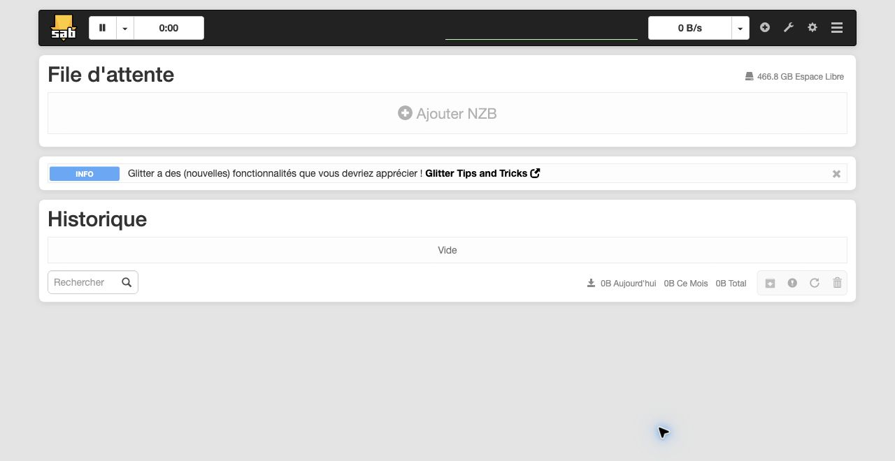
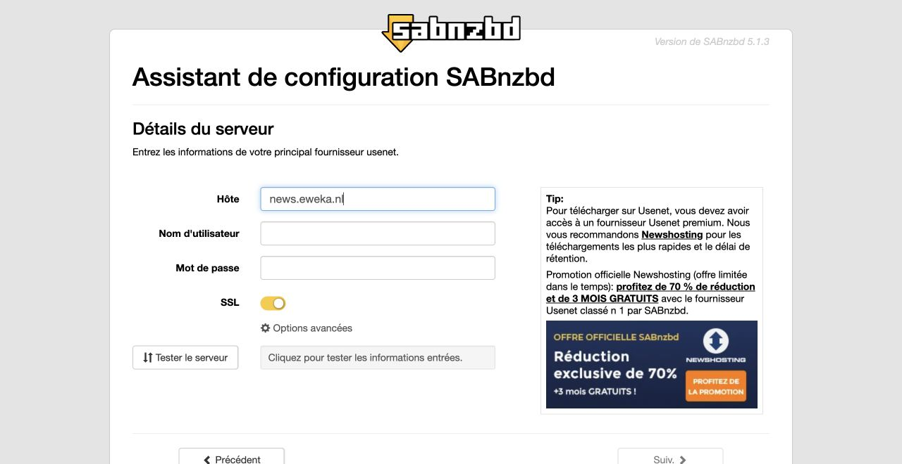

# SABnzbd for Olares

An Olares application package for [SABnzbd](https://sabnzbd.org/), using the [LinuxServer.io image](https://docs.linuxserver.io/images/docker-sabnzbd/).

## Status

Package 0.1.1 passes the official Olares chart checks and is installed on a live Olares system. SABnzbd 5.1.3 opens successfully through the private Olares entrance. The Eweka SSL connection test has passed; download benchmarks are pending; no throughput claim has been validated.





The screenshot shows the actual installed application before entering any provider credentials.  

## Storage and memory

- Configuration: persistent Olares AppData.
- Downloads: `Home/Downloads/SABnzbd/{incomplete,complete,watched}` on Olares.
- A single download volume permits atomic moves between incomplete and complete folders.
- Initial article cache: 256 MB. Memory request: 128 MiB; container limit: 2 GiB. Actual use depends on downloads, repair and unpacking.
- No GPU, host networking, privileged container or public entrance is required.
- Browser authentication is provided by the private Olares gateway. SABnzbd allows proxied web access (`inet_exposure=4`); API key protection and hostname checks remain enabled. Do not expose the container directly without configuring SABnzbd authentication.
- The upstream LinuxServer startup initializes permissions as root and runs SABnzbd as UID/GID 1000.

## Build and install

Requires Olares 1.12.6 or newer and the official Olares CLI.

```sh
olares-cli chart lint charts/sabnzbd
olares-cli chart package charts/sabnzbd -o dist
```

In Olares Market, open **My Olares → Upload custom app package** and select the generated package. Install SABnzbd, open its private entrance, and configure your own Usenet provider. Use SSL when supported.

The initial configuration is created only when no configuration exists. Upgrades preserve provider credentials and user settings. Keep API keys and provider credentials out of screenshots and issue reports.

## Upstream

- SABnzbd: https://github.com/sabnzbd/sabnzbd (GPL-2.0)
- Container: https://github.com/linuxserver/docker-sabnzbd
- Olares packaging: https://www.olares.com/docs/developer/develop/package/manifest

The SABnzbd name and logo belong to their respective owners. This is a community Olares package.
